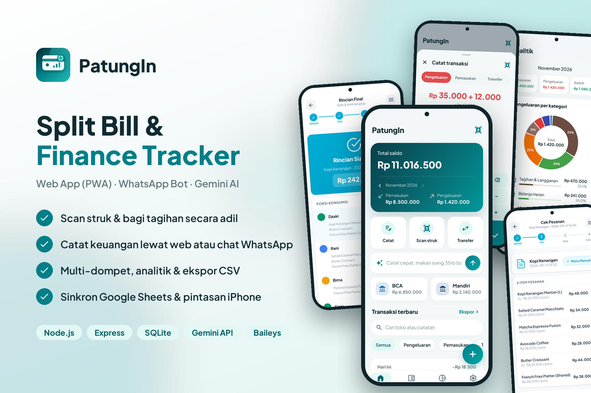
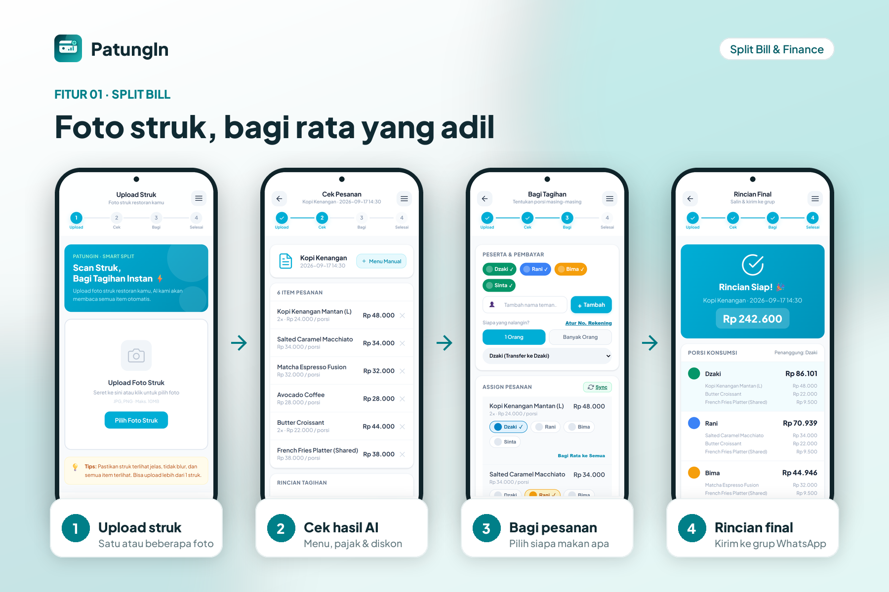
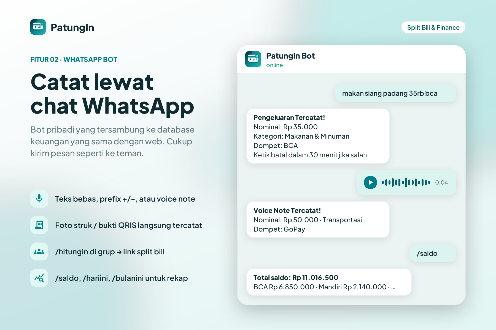
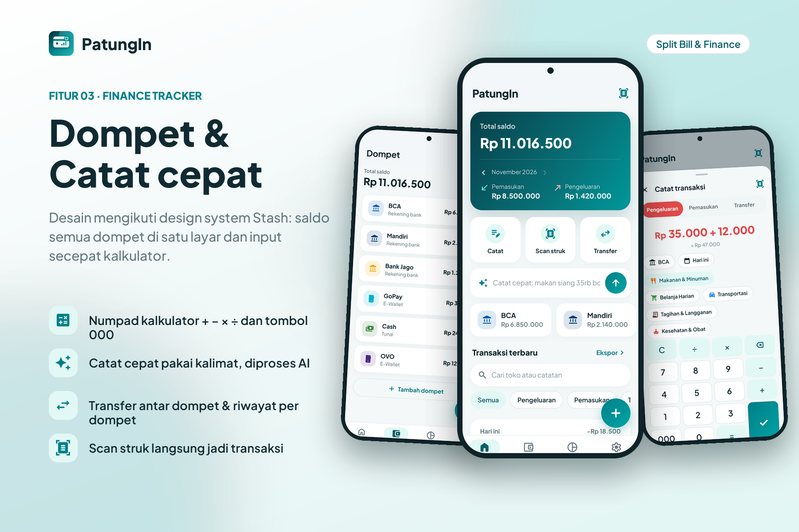
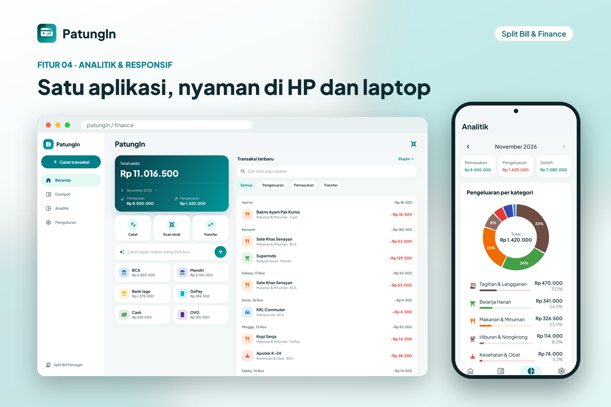
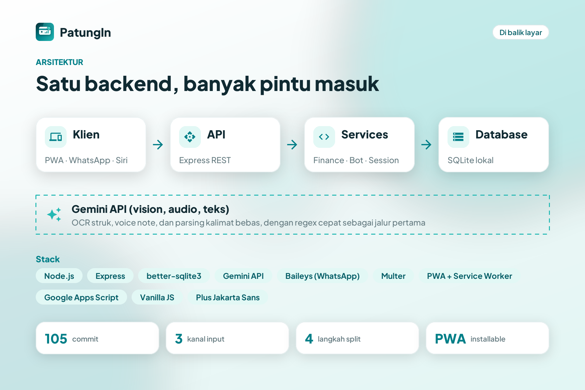

# PatungIn

> **Smart receipt split bill & personal finance tracker — web app (PWA), WhatsApp bot, and Gemini AI.**



PatungIn is a mobile-first web application with two jobs:

1. **Split bill** — snap a restaurant receipt, let Google Gemini Vision read the items, tax, and service charge, then split the bill *proportionally* to what each person ordered and send the breakdown to WhatsApp.
2. **Finance tracker** — a personal ledger with multiple wallets, quick entry, and analytics. Transactions can be recorded from the web dashboard, from a WhatsApp chat (text, voice note, or receipt photo), or from an iPhone Shortcut.

The finance dashboard follows the design system of **Stash**, the companion Android app: same color tokens, Plus Jakarta Sans, Material Rounded icons, calculator numpad, and bottom navigation.

---

## Features

### Split bill (`/`)
- **Receipt OCR with Gemini Vision**: merchant, line items, quantity, unit price, PB1 tax, service charge, and discounts. Multiple photos per bill are supported.
- **4-step flow**: Upload → Cek (review and edit) → Bagi (choose participants, the payer, and who ordered what) → Selesai (per-person totals).
- **Proportional fair split** of tax and service charge, with optional rounding and multi-payer support.
- **Collaborative sessions**: share a link so friends can claim their own items; started from a WhatsApp group with `/hitungin`.
- **WhatsApp export** of the final breakdown, including payment details.
- **Offline presets** (sample receipts) for testing without an API key.

### Finance tracker (`/finance`)
- **Beranda**: total balance hero card with month switcher, quick actions (Catat, Scan struk, Transfer), AI quick-entry ("makan siang padang 35rb bca"), wallet chips, and day-grouped transaction history with search and filters.
- **Catat transaksi**: expense / income / transfer tabs, a calculator numpad (`+ − × ÷`, `000`), wallet and category chips, and keyboard support on desktop.
- **Dompet**: all wallets (bank, e-wallet, cash, investment), per-wallet history, add/edit wallets with presets.
- **Analitik**: income / expense / net summary, an interactive category donut chart, and a 6-month spending trend.
- **Pengaturan**: bank statement import (text or CSV with preview), CSV export, Google Sheets sync via Apps Script, and iPhone Shortcut / Siri endpoint.
- **PWA**: installable to the home screen, with a service worker cache.

### WhatsApp bot (owner DM)
- Log transactions with free text, quick prefixes (`+50rb gaji`, `-18k kopi gopay`), voice notes, or receipt / QRIS photos.
- Recaps: `/saldo`, `/hariini`, `/bulanini`; undo with `batal` within 30 minutes; `/dashboard` for the web link.
- Group chats: `/hitungin` with a receipt photo starts a split bill session.

---

## Screenshots

| Split bill | WhatsApp bot |
|---|---|
|  |  |
| **Finance tracker** | **Analytics & responsive** |
|  |  |

All screenshots use fictional demo data. Raw screens are in [`docs/portfolio/screens/`](docs/portfolio/screens/).

---

## Architecture



```
Clients (PWA web · WhatsApp · iPhone Shortcut)
        │
        ▼
Express REST API (server.js)
        │
        ├── services/financeService.js   wallets, transactions, analytics, import/export, Sheets sync
        ├── services/whatsappBot.js      Baileys bot: finance logging, recaps, group split bill
        ├── services/sessionStore.js     shared split bill sessions
        ├── services/geminiService.js    receipt OCR, voice and text parsing (with model fallback)
        └── services/db.js               SQLite schema and seed data
```

Text input is parsed with fast regex rules first; Gemini is only called for ambiguous text, images, and audio.

---

## Getting Started

### Prerequisites
- [Node.js](https://nodejs.org/) 18 or newer
- A [Google AI Studio API key](https://aistudio.google.com/app/apikey) (optional, for real receipt OCR and AI parsing)

### Installation

```bash
git clone https://github.com/dzakiabrar21/patungin.git
cd patungin
npm install
cp .env.example .env   # then set GEMINI_API_KEY
npm start              # or: npm run dev
```

Open `http://localhost:3000` for split bill and `http://localhost:3000/finance` for the finance tracker. Starting the server also starts the WhatsApp bot; link it from the hidden `/wa-login` page (protected by an admin PIN).

### Import data from Money Manager (optional)

```bash
npm run import:mmbak
```

---

## Project Structure

```
patungin/
├── public/
│   ├── index.html            # Split bill app
│   ├── finance.html          # Finance tracker (Stash design system)
│   ├── css/                  # style.css (split bill), finance.css (finance tracker)
│   ├── js/                   # app.js (split bill), finance.js (finance tracker)
│   ├── assets/fonts/         # Plus Jakarta Sans (SIL OFL 1.1)
│   ├── manifest.json, sw.js  # PWA
│   └── wa-login.html         # WhatsApp pairing (admin only)
├── services/                 # finance, WhatsApp bot, Gemini, sessions, database
├── scripts/                  # import and maintenance scripts
├── docs/portfolio/           # showcase images, screenshots, portfolio write-up
└── server.js                 # Express server
```

---

## Portfolio

Showcase images and a portfolio write-up (Indonesian) are in [`docs/portfolio/`](docs/portfolio/). To regenerate the images from the screenshots:

```bash
python docs/portfolio/make_showcase.py
```

---

## License

MIT, as declared in `package.json`. Plus Jakarta Sans is bundled under the SIL Open Font License 1.1 (`public/assets/fonts/OFL.txt`).
